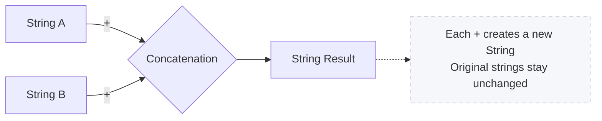
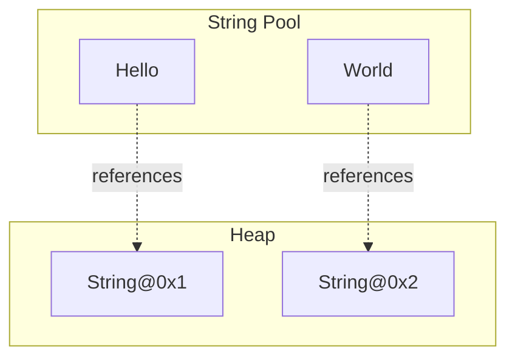

# Java Strings Lab

## What you'll learn

- Create, inspect, and transform text with the core `String` API
- Compare strings safely with `equals()`, `equalsIgnoreCase()`, and `compareTo()` instead of `==`
- Explain immutability and the string pool, and prove both with `==` and identity hash codes
- Assemble text with `StringBuilder` (and meet `StringBuffer`, its synchronised twin), and know why `+` in a loop costs more with every round
- Spot and fix common string bugs, from missing null checks to `substring` bounds and regex traps

## Table of Contents

1. [Introduction](#1-introduction)
2. [Creating and Inspecting Strings](#2-creating-and-inspecting-strings)
3. [Concatenation and Formatting](#3-concatenation-and-formatting)
4. [Comparing Strings](#4-comparing-strings)
5. [Immutability, the Pool, and Memory](#5-immutability-the-pool-and-memory)
6. [Working with StringBuilder](#6-working-with-stringbuilder)
7. [Common String Methods](#7-common-string-methods)
8. [Common Mistakes and Debugging](#8-common-mistakes-and-debugging)

## Getting started

This lab lives in the package `week06.strings_lab` - this folder. A runnable `Main.java` is already here: open this folder in VS Code or your Codespace, click ▶ on `Main.java` to check your setup works. Write each exercise in the `main` method of this one `Main.java`. Before you replace an exercise's code with the next one's, keep it safe: commit it (Source Control panel), or comment it out (select the lines, then Ctrl+/). When an exercise asks you to define a class, give that class its own file beside `Main.java`: `BuggyStrings.java` for DIY 8. Every new file starts with the package line you see in `Main.java`.

---

## 1. Introduction

### Explanation

Strings are sequences of characters that power almost every Java application. From user input and configuration to network communication and file handling, mastering strings is essential. Java represents strings with the `String` class, which provides a rich set of built-in capabilities for creating, transforming, and inspecting textual data.

**Why Focus on Strings?**

* **Universal:** Text is everywhere - log messages, prompts, file formats, and user interfaces.
* **Feature-Rich API:** `String` offers dozens of methods for searching, replacing, slicing, formatting, and more.
* **Immutable by Design:** Java strings cannot change once created, a feature that simplifies reasoning but affects performance.
* **Interoperability:** Strings integrate seamlessly with Java's standard library, including collections, streams, and I/O.

**Key Concepts:**

* **String Literal:** Characters enclosed in double quotes, e.g., `"Hello"`.
* **String Object:** An instance of the `String` class; may be created with literals or with `new`.
* **Immutability:** String contents never change; method calls return new objects instead.
* **String Pool:** A JVM-managed cache for literal strings that saves memory.

### DIY 1: First strings

**Objective:** Prepare your environment and experiment with basic strings.

1. Open the `Main` class in the `week06.strings_lab` package.
2. In the `main` method, declare three string variables using literals.
3. Print them to confirm everything compiles.

**Expected output**

```text
Hello
Java
Strings
```

*A representative run - your three strings can hold any values you like.*

<details><summary>Hint</summary>

This one is a setup check rather than a puzzle: if it compiles and prints three lines, your package and run button are working and the rest of the lab will behave. Declare each variable with a literal in double quotes (`String a = "Hello";`) rather than `new String(...)` - the difference between those two forms is the whole subject of section 5, so it is worth being in the habit before you get there.

</details>

---

## 2. Creating and Inspecting Strings

### Explanation

Strings can be created with literals or constructors. Once created, you can query information about them.

```java
String literalGreeting = "Welcome to Java Strings"; // literal, lives in the string pool
String constructedGreeting = new String("Welcome to Java Strings"); // forces new object
```

**Inspection Methods:**

* `length()` - counts characters.
* `charAt(int index)` - retrieves a single character.
* `isEmpty()` / `isBlank()` - checks for empty or whitespace-only strings (Java 11+).
* `toUpperCase()` / `toLowerCase()` - returns uppercase or lowercase versions.

### Example

```java
package week06.strings_lab;

public class StringInspector {
	public static void main(String[] args) {
		String message = "Java Strings Lab";
		System.out.println("Message: " + message);
		System.out.println("Length: " + message.length());
		System.out.println("First char: " + message.charAt(0));
		System.out.println("Uppercase: " + message.toUpperCase());
		System.out.println("Lowercase: " + message.toLowerCase());
		System.out.println("Is empty? " + message.isEmpty());
	}
}
```

### DIY 2: Inspect strings

**Objective:** Read a string's length and characters, and tell an empty string from a blank one.

1. In `Main.java`'s `main` method, create `String text = "Learning Java";` and print its length, its first character and its last character.
2. Create `String empty = "";` and `String spaces = "   ";` (three spaces). For each, print whether it is empty with `isEmpty()` and whether it is blank with `isBlank()`, in the form shown below.

**Expected output**

```text
Length: 13
First: L
Last: a
Empty string - empty? true, blank? true
Three spaces - empty? false, blank? true
```

<details><summary>Hint</summary>

The last character lives at index `length() - 1`, here `text.charAt(12)`. Never call `charAt(0)` on an empty string: it has no index 0, so the call throws `StringIndexOutOfBoundsException`. `isEmpty()` is true only when there are no characters at all; `isBlank()` is also true when every character is a space.

</details>

---

## 3. Concatenation and Formatting

### Explanation

Combining strings is a common task. Java supports several approaches:

* **Concatenation Operator (`+`):** the natural choice for a handful of pieces - a single `+` expression is compiled into efficient building for you. Inside a loop it is a different story, which section 6 explains.
* **`concat()` Method:** Equivalent to `+` for straightforward joins.
* **`String.format()` / `printf()`:** Allows templates with placeholders.
* **`String.join()` and `String.join(System.lineSeparator(), ...)`:** Ideal for joining collections or arrays.

```java
String title = "Java";
String topic = "Strings";
String combined = title + " " + topic; // "Java Strings"
String templated = String.format("%s Lab - %d modules", title, 10);
```

### Mermaid Diagram: Concatenation Flow



### DIY 3: Concatenate and format

**Objective:** Experiment with multiple concatenation strategies.

1. In `Main.java`'s `main` method, create two String variables `title` with value `"Java"` and `topic` with value `"Strings"`. Use the `+` operator to concatenate them with a space in between and display the result.
2. Create three variables: `name` (String) holding `"Ade"`, `age` (int) holding `21`, and `course` (String) holding `"OOP"`. Use `String.format("Name: %s, Age: %d, Course: %s", name, age, course)` to create a formatted sentence and print it.
3. Create a String array with the words `{"Java", "Strings", "are", "powerful"}`. Use `String.join(" ", array)` to join them with spaces and print the result.

**Expected output**

```text
Using + : Java Strings
Formatted: Name: Ade, Age: 21, Course: OOP
Joined: Java Strings are powerful
```

<details><summary>Hint</summary>

In a format string, `%s` is a placeholder for a String and `%d` for an int. `String.join(" ", words)` takes the separator first and the array second - no loop required.

</details>

---

## 4. Comparing Strings

### Explanation

String comparisons must use methods, not `==`, which only checks whether references point to the same object.

* `equals(Object obj)` - case-sensitive equality.
* `equalsIgnoreCase(String other)` - case-insensitive equality.
* `compareTo(String other)` - lexicographic comparison (negative, zero, positive).
* `regionMatches(...)` - compare substrings.

```java
String expected = "SUCCESS";
String actual = "success";
System.out.println(expected.equals(actual));          // false
System.out.println(expected.equalsIgnoreCase(actual)); // true
```

### DIY 4: Compare strings

**Objective:** Practice comparing strings safely.

1. In `Main.java`'s `main` method, create two String variables `str1` and `str2` both with the value `"Java"`. Use `equals()` to compare them and print the result.
2. Create two String variables `str3` with value `"Java"` and `str4` with value `"java"`. Use `equalsIgnoreCase()` to compare them and print the result.
3. Create two String variables `str5` with value `"Java"` and `str6` with value `"Kotlin"`. Use `compareTo()` to compare them alphabetically and print the result (negative means `str5` comes before `str6`).
4. Create a String variable `str7` and assign it `null`. Before calling any string method on it, add an if statement to check `if (str7 != null)` to avoid a `NullPointerException`.

**Expected output**

```text
Equal? true
Equal ignore case? true
Order (Java vs Kotlin): -1
Null-safe comparison passed.
```

<details><summary>Hint</summary>

`compareTo` works alphabetically: `"Java".compareTo("Kotlin")` is negative because `'J'` comes before `'K'`. In the null test, the `!= null` check must run first - `str7 != null && str7.equals("Java")` can never throw.

</details>

---

## 5. Immutability, the Pool, and Memory

### Explanation

Strings are immutable - once created, their value cannot change. Any method that appears to modify a string actually returns a new instance.

**Benefits:**

* Thread-safety without extra synchronisation.
* Security for values like configuration keys or user names.
* Caching via the **string pool**, which stores literal strings for reuse.

**Implications:**

* Frequent changes create many short-lived objects.
* Use builders for heavy modifications or loops.

```java
String original = "Java";
String modified = original + " Strings"; // original stays "Java"
```

**Where those objects actually live:**

* Literals go into the string pool, so two identical literals share one object.
* `new String(...)` builds a distinct heap object every time, even when a literal with the same text already exists.

### Memory Layout Diagram



### DIY 5: Prove immutability and the pool

**Objective:** Prove that a String never changes, and that literals are shared.

1. In `Main.java`'s `main` method, test immutability: create a String variable `original` with value `"Hello"`. Store `System.identityHashCode(original)` in an `int` before you touch it, reassign `original = original + " World"`, then store the identity hash code again. Print whether the two numbers are equal, then print the text.
2. Test the string pool: create two String variables using literals, `String lit1 = "Lab"` and `String lit2 = "Lab"`. Compare them with `==` and print the result.
3. Test `new`: create `String heap1 = new String("Lab")` and `String heap2 = new String("Lab")`. Print whether `heap1 == heap2`, then print whether `heap1 == lit1`.
4. Test `intern()`: print whether `heap1.intern() == lit1`. Note that `intern()` *returns* the pooled object rather than changing `heap1`, so the result has to be used or assigned.

**Expected output**

```text
Same object after concat? false
Text now: Hello World
Two literals are the same object? true
Two new Strings are the same object? false
A new String is the pooled object? false
intern() returns the pooled object? true
```

*Identity hash codes differ from run to run, which is why this exercise prints the comparison rather than the number - every line above is the same on every run.*

<details><summary>Hint</summary>

`System.identityHashCode(obj)` describes the object itself, not its contents: the same object always reports the same number, and two different objects usually - though not always - report different ones. That "usually" is why the exercise prints `before == after` instead of the numbers, and why `==` on the strings themselves is the stronger evidence. `intern()` asks the pool for the shared copy of that text and hands it back, so `heap1.intern() == lit1` is `true` even though `heap1 == lit1` is `false`. Remember to reassign the result of concatenation - `original = original + " World";` - or nothing appears to change.

</details>

---

## 6. Working with StringBuilder

### Explanation

`StringBuilder` provides a mutable sequence of characters, ideal for repeated modifications. Unlike strings, builders modify their internal buffer instead of creating new objects.

**Key Methods:**

* `append(...)` - add text or values.
* `insert(int offset, String str)` - insert at position.
* `delete(int start, int end)` - remove a range.
* `reverse()` - reverse contents.
* `toString()` - produce an immutable `String` snapshot.

```java
StringBuilder sb = new StringBuilder("Java");
sb.append(" ").append("Strings");
String result = sb.toString();
```

`StringBuffer` is the older sibling: same method names, same behaviour, one difference. Every `StringBuffer` method is synchronised, so several threads can share one buffer safely - and that lock costs time no single-threaded program ever gets back. Hence the three-way choice: `String` for text you read, pass and compare; `StringBuilder` for assembling; `StringBuffer` only when threads genuinely share one builder.

Why bother? A `+=` inside a loop cannot add to its String: every round builds a brand-new String and copies everything built so far into it, so the work grows with the square of the length. A builder writes each character once, into one object. A single `+` expression is fine; `+` inside a loop is the one to replace.

### DIY 6: Build with StringBuilder

**Objective:** Edit one builder in place, build text in a loop, and meet `StringBuilder`'s synchronised twin.

1. In `Main.java`'s `main` method, create `StringBuilder word = new StringBuilder("stressed");`, call `reverse()` on it, and print it after `Reversed: `.
2. Build a menu: create an empty `StringBuilder` and, in a `for` loop from 1 to 3, append one numbered line for each of `"Start"`, `"Settings"` and `"Exit"`, each ending in `"\n"`. After the loop, `insert` the heading `"Menu:\n"` at index 0, turn the builder into a String with `toString()`, and print that String.
3. Change the menu's `StringBuilder` to a `StringBuffer` and run it again. The output does not change: the two classes share their methods, and a `StringBuffer` only adds a lock so that several threads can share one.

**Expected output**

```text
Reversed: desserts
Menu:
1. Start
2. Settings
3. Exit
```

<details><summary>Hint</summary>

`reverse()` edits the builder itself, so there is no result to catch: print `word` straight after the call. Keep the three items in an array, `String[] items = {"Start", "Settings", "Exit"};`, so that round `i` of the loop appends `i`, then `". "`, then `items[i - 1]`, then the line break: `append` calls chain. `insert(0, ...)` puts its text in front of everything already in the builder.

</details>

---

## 7. Common String Methods

### Explanation

Java's `String` class provides diverse utility methods. Understanding their behavior prevents bugs and makes your code concise.

**Categories:**

* **Searching:** `contains`, `indexOf`, `lastIndexOf`.
* **Slicing:** `substring`, `subSequence`.
* **Replacement:** `replace`, `replaceAll`, `replaceFirst`.
* **Trimming:** `trim`, `strip`, `stripIndent` (Java 15+).
* **Splitting:** `split(String regex)`.

### Example

```java
String logEntry = "INFO: Connected at 10:45";
boolean containsTime = logEntry.contains("10:45");
String level = logEntry.substring(0, logEntry.indexOf(':'));
String replaced = logEntry.replace("INFO", "DEBUG");
String[] parts = logEntry.split(": ");
```

### DIY 7: Everyday string methods

**Objective:** Collect and practice essential methods.

1. In `Main.java`'s `main` method, do a case-insensitive search: create a String `text = "Java is a powerful programming language"` and `keyword = "POWERFUL"`. Convert both to lowercase with `toLowerCase()` and use `contains()` to check if the text contains the keyword. Print the result.
2. Extract initials: create a String `fullName = "John Doe"`. Use `split(" ")` to get an array of names. Loop through the array, use `charAt(0)` to get the first character of each name, and build the initials (e.g., `J.D.`). Print the result.
3. Mask an email: create a String `email = "john@example.com"`. Use `indexOf('@')` to find the `@` position. Use `substring(0, atIndex)` to get the local part and `substring(atIndex)` to get the domain. Build a masked version: keep the first character, replace the other local-part characters with `*`, then append the domain. Print the result.

**Expected output**

```text
Contains keyword? true
Initials: J.D.
Masked email: j***@example.com
```

<details><summary>Hint</summary>

For the mask, everything between index `1` and `atIndex` needs replacing - `"*".repeat(atIndex - 1)` builds all the stars in one call. The initials are built in a loop, so a `StringBuilder` is the tool for them.

</details>

---

## 8. Common Mistakes and Debugging

### Explanation

Awareness of frequent pitfalls helps you debug faster and write robust string code.

**1. Using `==` Instead of `equals`**

```java
String input = new String("YES");
System.out.println(input == "YES");    // false
System.out.println(input.equals("YES")); // true
```

**2. Ignoring Immutability in Loops**

```java
String result = "";
for (int i = 0; i < 1000; i++) {
	result += i; // each round copies everything built so far, then discards it
}
```

**3. Forgetting Null Checks**

```java
String value = null;
if (value != null && value.contains("ok")) {
	System.out.println("Contains ok");
}
```

**4. Misusing Regex in `replaceAll`**

`replaceAll` treats the first argument as a regular expression. Use `replace` for literal replacements.

**5. Off-by-One Errors with `substring`**

Remember: `substring(start, end)` includes `start` but excludes `end`.

### Debugging Tips

* Log intermediate strings with context labels.
* Print identity hash codes to confirm whether objects change - the same object always reports the same number, and different objects usually report different ones.
* Use your IDE debugger to inspect string values step by step.

### DIY 8: Fix the bugs

**Objective:** Find and fix five classic string bugs.

Each method in this class carries one labelled bug:

```java
package week06.strings_lab;

public class BuggyStrings {

	// Bug 1: == compares objects, not text
	public boolean isYes(String input) {
		return input == "YES";
	}

	// Bug 2: crashes when text is null
	public boolean hasKeyword(String text, String keyword) {
		return text.contains(keyword);
	}

	// Bug 3: should return the first three characters
	public String firstThree(String input) {
		return input.substring(0, 3 + 1);
	}

	// Bug 4: should remove the dots, but removes everything
	public String removeDots(String version) {
		return version.replaceAll(".", "");
	}

	// Bug 5: should return the text in capitals
	public String shout(String text) {
		text.toUpperCase();
		return text;
	}
}
```

1. Copy the class into its own file, `BuggyStrings.java`, beside `Main.java`.
2. In `Main.java`'s `main`, create a `BuggyStrings` object and print the result of each of these calls, labelled as shown below: `isYes(new String("YES"))`, `hasKeyword(null, "java")`, `firstThree("Strings")`, `removeDots("1.2.3")` and `shout("hi")`. Run it: some answers are wrong, and the `null` call crashes.
3. Fix the five bugs one at a time, running after each fix, until your output matches.

**Expected output**

```text
Is YES? true
Keyword in null text? false
First three: Str
Without dots: 123
Shouted: HI
```

<details><summary>Hint</summary>

Bug 1: compare text with `equals`, never `==`. Bug 2: check `text != null` before calling anything on it - `text != null && text.contains(keyword)` can never throw. Bug 3: `substring`'s end index is left out, so the first three characters are `substring(0, 3)`. Bug 4: `replaceAll` reads its first argument as a pattern, in which `.` means any character; `replace` treats it as a plain dot. Bug 5: `toUpperCase()` builds a new String and leaves the old one alone, so return the new one.

</details>

---

## Summary

This lab guided you through essential string concepts:

* Declaring, inspecting, and transforming strings.
* Comparing strings safely and handling nulls.
* Understanding immutability, the string pool, and where string objects live, and proving it with identity hash codes.
* Assembling text with `StringBuilder`, and meeting `StringBuffer`, its synchronised twin.
* Applying core string methods for real-world tasks, and fixing the classic string bugs.

### Key Takeaways

✅ Strings are immutable; every change creates a new object.

✅ Identity hash codes show that `+` gives you a new String object - the same object always reports the same number, and two different objects usually report different ones.

✅ Avoid `==` for string comparisons - use `equals` or `equalsIgnoreCase`.

✅ `StringBuilder` is the go-to for repeated concatenation or heavy editing; `StringBuffer` shares its API and adds a thread-safety lock you rarely need.

✅ `+` in a loop copies everything built so far on every round, so the work grows with the square of the length; a builder writes each character once.

✅ Always validate inputs to prevent null pointer issues.

✅ Remember substring's inclusive/exclusive indices.

### Best Practices Checklist

✔ Use literals for fixed text; call `intern()` only when measuring memory.

✔ Prefer builders or `String.join` when merging collections or loops.

✔ Guard against `null` before calling string methods.

✔ Document assumptions about casing, whitespace, and locales.

✔ A handful of pieces in one expression? `+` is fine. Assembling inside a loop? Reach for a `StringBuilder`.
