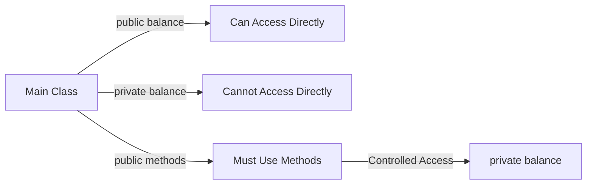
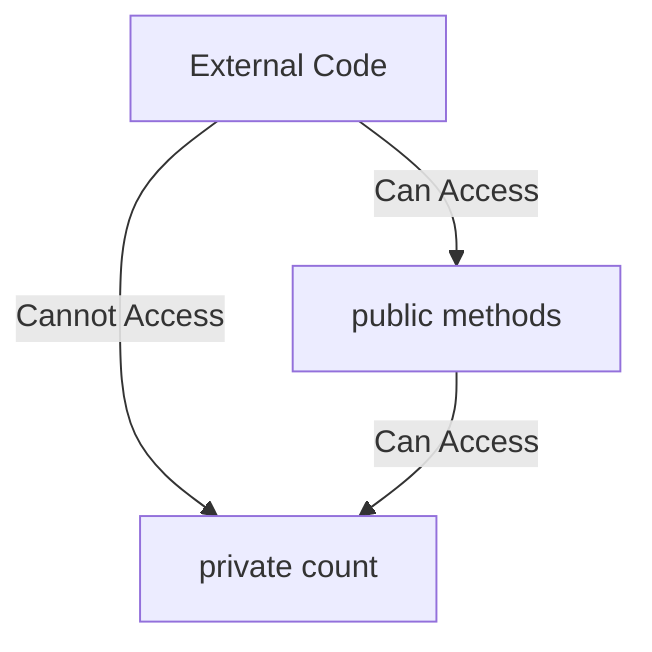
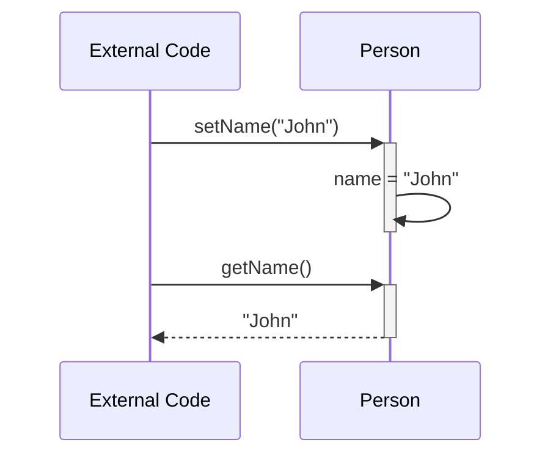

# Java Encapsulation Lab

## What you'll learn

**Encapsulation** is one of the four fundamental principles of Object-Oriented Programming (OOP), alongside inheritance, polymorphism, and abstraction: bundling data (fields) and the methods that operate on that data within a single unit (a class), while restricting direct access to some of the object's components. Think of it as a capsule or protective shell around your data - just as you can't reach the medicine inside a pill capsule without breaking it open, you shouldn't be able to reach an object's internal data without going through its controlled interface. By the end of this lab you will be able to:

- Explain why encapsulation matters: it protects an object's state from accidental or malicious corruption, lets you change internal implementation without affecting code that uses your class, keeps code maintainable by clearly separating internal from external, and enables validation so data stays valid throughout an object's lifetime.
- Use the `public` and `private` access modifiers to control the visibility of class members, and see the effect first-hand in VS Code's IntelliSense.
- Hide an object's data behind private fields so external code cannot corrupt its state.
- Provide controlled read and write access to private fields with getter and setter methods.
- Validate data in both constructors and setters through one private helper method, and return a defensive copy so that a getter never hands out a private array.

## Table of Contents
1. [Access Modifiers](#1-access-modifiers)
2. [Data Hiding](#2-data-hiding)
3. [Getters and Setters](#3-getters-and-setters)
4. [Validation and Defensive Copies](#4-validation-and-defensive-copies)

## Getting started

This lab lives in the package `week07.encapsulation_lab` - this folder. A runnable `Main.java` is already here: open this folder in VS Code or your Codespace, click ▶ on `Main.java` to check your setup works. Use this one `Main.java` throughout the lab to create and test your objects; replace its test code as each exercise develops the program. When an exercise asks you to define a class, give that class its own file beside `Main.java`: `Student.java` for DIY 1, `SecretMessage.java` for DIY 2, and so on. Every new file starts with the package line you see in `Main.java`.

## 1. Access Modifiers

Access modifiers are keywords that set the accessibility level of classes, methods, and fields. The two most common access modifiers are:
- **public**: The member is accessible from anywhere in your program
- **private**: The member is only accessible within the same class

When you use the dot operator (`.`) on an object we create in the `main` method in VS Code, IntelliSense shows you a list of all the members you can access. This is a powerful visual demonstration of encapsulation in action - when you make a field private, it disappears from the list of accessible members.

### Example: The Problem with Public Fields
```java
public class BankAccount {
    public double balance;  // Public - accessible from anywhere!
    
    public BankAccount(double initialBalance) {
        balance = initialBalance;
    }
}
```

### What Can Go Wrong?
When fields are public, anyone can modify them directly, potentially breaking business rules:

```java
public class Main {
    public static void main(String[] args) {
        BankAccount account = new BankAccount(1000.00);
        
        // This should NOT be allowed, but it is!
        account.balance = -500.00;  // Negative balance! - Not Allowed in this case
        
        System.out.println("Balance: " + account.balance);
    }
}
```

### The Solution: Private Fields
```java
public class BankAccount {
    private double balance;  // Private - only accessible within this class
    
    public BankAccount(double initialBalance) {
        balance = initialBalance;
    }
    
    public void deposit(double amount) {
        if (amount > 0) {
            balance += amount;
        }
    }
    
    public double getBalance() {
        return balance;
    }
}
```

### Visual Representation


### DIY 1: Access modifier demonstration

**Part 1: Public field problems**

1. Create a `Student` class with the following **public** fields:
   - `name` (String)
   - `studentId` (int)
   - `gpa` (double)
2. Add a constructor that accepts all three parameters.
3. In `Main.java`'s `main` method, create a `Student` object, type `student.` and observe the autocomplete list in VS Code - you see `name`, `studentId`, `gpa`, and more: all fields appear in the list.
4. Set invalid values directly:

   <!-- no-compile -->
   ```java
   student.studentId = -1;  // Invalid ID
   student.gpa = 5.5;        // GPA above 4.0
   ```

**Part 2: Fixing with private fields**

5. Change all fields in the `Student` class to **private**.
6. In `Main.java`, type `student.` again and observe the autocomplete list - `name`, `studentId` and `gpa` have disappeared from the list and are inaccessible.
7. Try to access `student.name` directly - you'll get a compilation error.

The private fields have "disappeared" from outside access! Later we will show how to create public **getter** and **setter** methods that will provide access to these private instance variables.

**Expected output**

Once the fields are private, the compiler rejects every direct field access from `Main`:

```text
error: name has private access in Student
```

<details>
<summary>Hint</summary>

After you make the fields private, the direct assignments from Part 1 (`student.studentId = -1;` and `student.gpa = 5.5;`) stop compiling too. Hover over each red underline in VS Code to read the compiler error, then comment those lines out (and the `student.name` line from step 7) so the rest of your `main` method can run.

</details>

### Key Takeaway
The disappearance of private members from the autocomplete list is not just a convenience feature - it's the IDE enforcing Java's encapsulation rules. If you can't see it in the list, you can't access it directly. This is encapsulation protecting your data.

## 2. Data Hiding

Data hiding is the fundamental concept of encapsulation where we restrict direct access to certain components of an object, typically by making fields private. This protection prevents unauthorized access to internal data and helps maintain the object's state consistency. By controlling access to our object's data, we can ensure that the object's state is always valid and can't be corrupted by external code.

Now that you've seen how access modifiers work in Section 1, this section reinforces why we consistently make fields private and only expose what's necessary through public methods.

### Example
```java
public class Counter {
    private int count; // Private field - cannot be accessed directly from outside
    
    public void increment() {
        count++;
    }
    
    public void displayCount() {
        System.out.println("Current count: " + count);
    }
}
```

### Visual Representation


### DIY 2: Secret message

Create a `SecretMessage` class that keeps its data hidden:

1. Give the class a private String field to store a message.
2. Add a public method to display the message.
3. Create a `SecretMessage` object in `Main.java`'s `main` method.
4. Try to call the message field directly using the dot operator - you should get a compilation error. Then comment that line out so the rest of `main` can run.
5. Print the message to the console using the public method.

**Expected output**

```text
The secret message is: Hello, Encapsulation!
```

When you try to access the private field directly (step 4), expect a compilation error like:

```text
error: message has private access in SecretMessage
```

<details>
<summary>Hint</summary>

Follow the same shape as the `Counter` example above: one private field, one public method that prints it. You can set the message where the field is declared, or in a constructor.

</details>

## 3. Getters and Setters

While private fields prevent direct access, we often need controlled ways to read and modify their values through getter and setter methods. Getter methods allow read access to private fields while maintaining encapsulation, and setter methods provide a way to modify private fields with proper validation. This approach gives us the flexibility to change how we store and validate data without affecting code that uses our class.

This is the standard way to expose private data: create a protective layer of public methods that control how the data can be accessed and modified.

### Example
```java
public class Person {
    private String name;
    
    // Getter method
    public String getName() {
        return name;
    }
    
    // Setter method
    public void setName(String name) {
        this.name = name;
    }
}
```

### Visual Representation


### DIY 3: Temperature converter

Create a `Temperature` class that:

1. Stores a temperature in a private double instance variable named `celsius`.
2. Provides a getter method for `celsius`.
3. Provides a setter method that accepts celsius values.

Then test your class in `Main.java`'s `main` method:

4. Create a `Temperature` object.
5. Set a temperature value using the setter.
6. Read the temperature value using the getter and print the result to the console.

**Expected output**

```text
Temperature: 25.0°C
```

<details>
<summary>Hint</summary>

Example test code for your `main` method:

<!-- no-compile -->
```java
Temperature temp = new Temperature();
temp.setCelsius(25.0);
System.out.println("Temperature: " + temp.getCelsius() + "°C");
```

</details>

## 4. Validation and Defensive Copies

Private fields leave a class with two gates to guard: what comes **in** through its constructor and setters, and what goes **out** through its getters.

### Guarding the way in: validation

Validate in the constructor, so that an object starts valid, and in every setter, so that it stays valid. Write the check once, in a private helper method, and call it from both - one rule, in one place:

```java
public class Student {
    private int age;

    public Student(int age) {
        this.age = validateAge(age);
    }

    public void setAge(int age) {
        this.age = validateAge(age);
    }

    // One check, used by the constructor and the setter alike
    private int validateAge(int age) {
        if (age < 16 || age > 100) {
            System.out.println("Invalid age " + age + ": must be between 16 and 100. Age set to 16.");
            return 16;   // fall back to a valid age so the object is never left invalid
        }
        return age;
    }

    public int getAge() {
        return age;
    }
}
```

### Guarding the way out: defensive copies

A getter can undo all of that. When a private field is an array, a getter that returns it hands the caller an arrow to the object's own array, not a copy of the values:

```java
public class Gradebook {
    private int[] scores = {70, 80, 90};

    public int[] getScores() {
        return scores;   // the caller gets the SAME array
    }
}
```

After `int[] view = gradebook.getScores();` and `view[0] = 0;`, the private field has changed: `gradebook.getScores()[0]` prints `0`, although no code ever assigned to `scores` and no check ever ran. The fix is to hand out a **defensive copy**, a new array with the same values, so that the caller can only ever change its own array:

```java
import java.util.Arrays;

public class Gradebook {
    private int[] scores = {70, 80, 90};

    public int[] getScores() {
        return Arrays.copyOf(scores, scores.length);   // a new array: the original stays sealed
    }
}
```

### DIY 4: Report card

Create a `ReportCard` class that guards both gates:

1. Give it a private field `int[] grades`.
2. Add a private helper `int validateGrade(int grade)` that returns the grade when it is between 0 and 100; otherwise it prints `Invalid grade <grade>: must be between 0 and 100. Set to 0.` and returns 0.
3. Add a constructor that takes an `int[]` of grades, makes `grades` a new array of the same length, and fills it by passing each value through `validateGrade`.
4. Add `setGrade(int index, int grade)`, which stores `validateGrade(grade)` at that index.
5. Add `getGrades()`, returning the `grades` field itself for now.

Then test it in `Main.java`'s `main`:

6. Create a `ReportCard` from `new int[] {88, 150, 76}`, then call `setGrade(2, -5)`.
7. Print the grades with `Arrays.toString(card.getGrades())`, labelled as shown below.
8. Leak test: store `card.getGrades()` in an `int[] view`, set `view[0] = 0;`, then print `card.getGrades()[0]`. It prints `0`: the private array changed from outside, past every check.
9. Change `getGrades()` to return `Arrays.copyOf(grades, grades.length)` and run again. The leak test now prints `88`.

**Expected output**

```text
Invalid grade 150: must be between 0 and 100. Set to 0.
Invalid grade -5: must be between 0 and 100. Set to 0.
Grades: [88, 0, 0]
After the leak test: 88
```

*This is the run after step 9's fix; before it, the last line prints `0`.*

<details>
<summary>Hint</summary>

`validateGrade` has the same shape as `validateAge` above: an `if` that prints the message and returns `0`, otherwise `return grade;`. In the constructor, `grades = new int[values.length];` makes the new array, then a `for` loop stores `validateGrade(values[i])` in each box - and because it is a new array, the caller's own array is never shared either. `Main.java` needs `import java.util.Arrays;` for `Arrays.toString`, and so does `ReportCard` once its getter returns `Arrays.copyOf(grades, grades.length)`. Before the fix, `view` and `grades` are two arrows to ONE array, which is why writing through `view` changes the field.

</details>

## Summary
This lab covered the essential concepts of encapsulation in Java:
1. **Access modifiers** and their effect on visibility - seeing how `public` and `private` control what can be accessed
2. **Data hiding** using private fields - understanding why we protect our data
3. **Controlled access** through getters and setters - learning how to safely expose data
4. **Validation and defensive copies** - guarding what comes in (the constructor and setters, through one private helper) and what goes out (getters that return copies of arrays)

By mastering these concepts, you can write more robust, maintainable, and secure Java applications. Encapsulation is not just a good practice - it's essential for professional software development.
