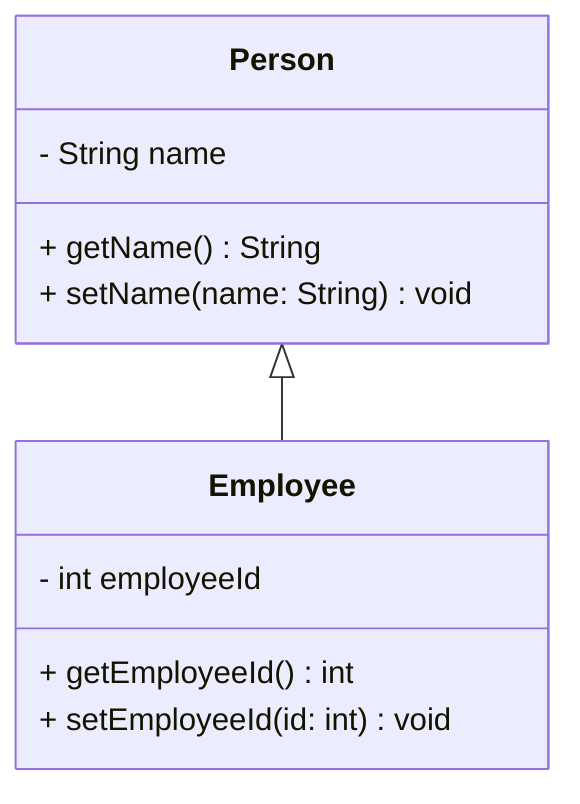
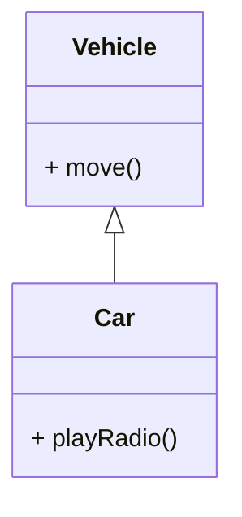
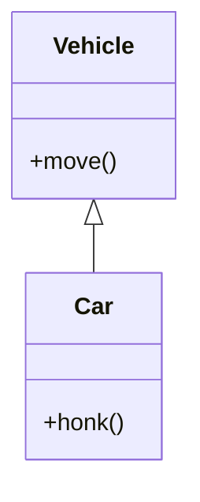
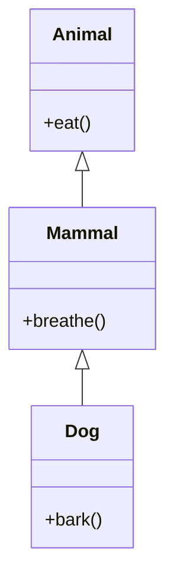
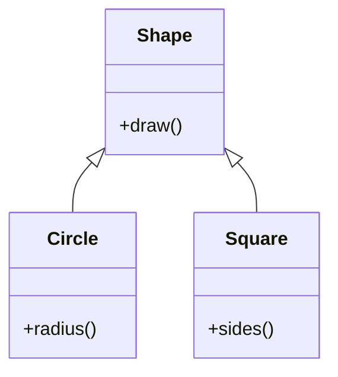
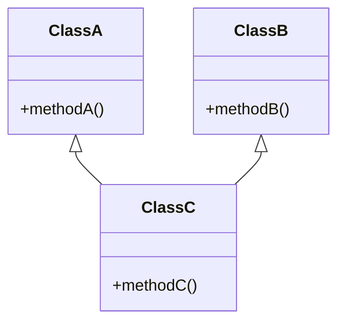
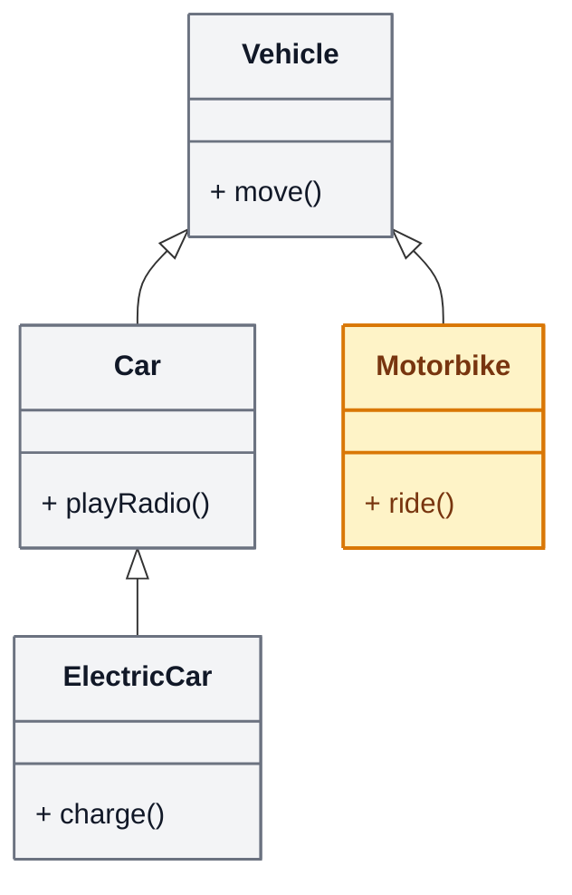
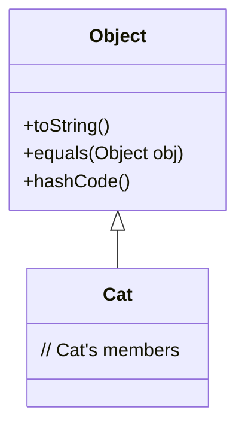
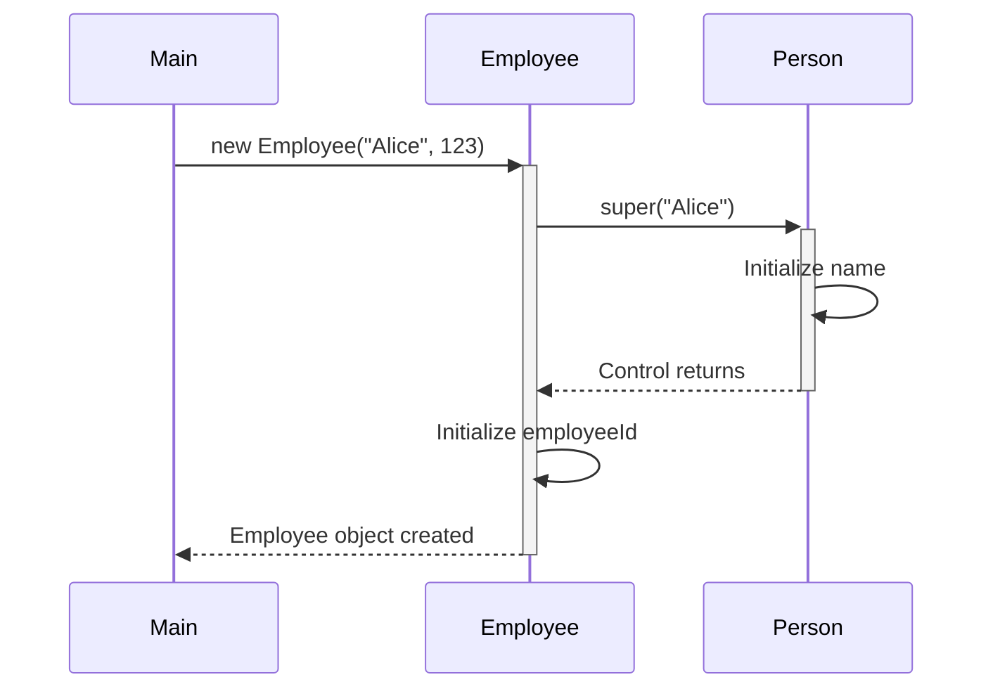
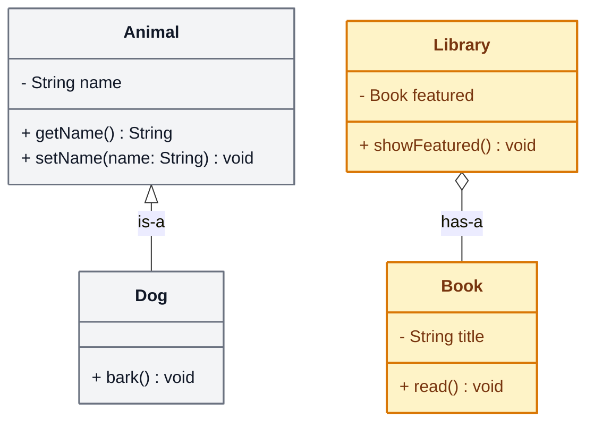

# Java Inheritance Lab

## What you'll learn

By the end of this lab you will be able to:

- Use `extends` so that one class (the subclass) acquires the fields and methods of another (the superclass), and explain the "Is-A" relationship this expresses
- Explain why a subclass cannot use its superclass's `private` fields directly, and reach them through inherited public methods or by making the field `protected`
- Recognise single, multilevel, hierarchical and hybrid inheritance, and explain why Java does not allow multiple inheritance of classes
- Explain the role of `Object` as the superclass of every class that does not name one
- Pass values to a superclass constructor with `super(...)`, and explain the compiler error you get without it
- Choose between inheritance and a field using the is-a / has-a sentence test

## Table of Contents

1. [Definition and Basics of Inheritance](#1-definition-and-basics-of-inheritance)
2. [Terminology](#2-terminology)
3. [Single and Multilevel Inheritance](#3-single-and-multilevel-inheritance)
4. [Hierarchical and Multiple Inheritance](#4-hierarchical-and-multiple-inheritance)
5. [The Object Class](#5-the-object-class)
6. [Constructors in Inheritance](#6-constructors-in-inheritance)
7. [Is-A or Has-A](#7-is-a-or-has-a)

## Getting started

This lab lives in the package `week09.inheritance_lab` - this folder. A runnable `Main.java` is already here: open this folder in VS Code or your Codespace, click ▶ on `Main.java` to check your setup works. Use this one `Main.java` throughout the lab to create and test your objects; replace its test code as each exercise develops the program. When an exercise asks you to define a class, give that class its own file beside `Main.java`: `Animal.java` and `Dog.java` for DIY 1, `Vehicle.java` and `Car.java` for DIY 2, and so on. Every new file starts with the package line you see in `Main.java`.

## 1. Definition and Basics of Inheritance

### Explanation

Inheritance is the mechanism by which one class acquires the fields and methods of another class. In Java you write it with the keyword `extends`: `class Employee extends Person` gives `Employee` the fields and methods of `Person`, and `Employee` can add fields and methods of its own.

Inheritance expresses an **"Is-A"** relationship: an Employee is a Person, so `Employee` can extend `Person`. It brings three benefits: **code reuse** (what every Person has is written once, in `Person`, instead of being copied into each class that needs it), **better organisation** (shared code has one home, at the top of the hierarchy) and **flexibility** (code written to work with a `Person` also works with every subclass of `Person`).

A subclass does **not** inherit the `private` members of its superclass. Every `Employee` object still contains a `name`, because an Employee is a Person, but only `Person`'s own code can use the field `name` directly. Code written inside `Employee` reaches the name through the public methods it does inherit, `getName()` and `setName()`.

### Example

```java
public class Person {
    private String name;

    public String getName() {
        return name;
    }

    public void setName(String name) {
        this.name = name;
    }
}

public class Employee extends Person {
    private int employeeId;

    public int getEmployeeId() {
        return employeeId;
    }

    public void setEmployeeId(int id) {
        this.employeeId = id;
    }
}
```

Using it in `Main.java`'s `main` method:

```java
Employee e = new Employee();
e.setName("Alice");       // inherited from Person
e.setEmployeeId(123);     // declared in Employee
System.out.println("Employee: " + e.getName() + ", ID: " + e.getEmployeeId());
```

This prints `Employee: Alice, ID: 123`. `Employee` declares two methods, and an `Employee` object can also use the two it inherits from `Person`.

### Visual Representation



This is a UML class diagram, the usual way to draw classes and their inheritance. Each box is a class: its name, then its fields, then its methods (`-` means private, `+` means public). The arrow with the hollow triangle points from the subclass to its superclass.

### DIY 1: Animals

1. Create an `Animal` class with a `private` field `name` (String) and a getter and setter for it.
2. Create a `Dog` class that `extends` `Animal`, with one method, `bark()`, that prints the dog's name followed by ` says Woof!`. Write it first with the field itself, `System.out.println(name + " says Woof!");`. It does not compile, and the error is `name has private access in Animal`.
3. Change `name` to `getName()` in that line. `getName()` is public, so `Dog` inherits it, and the line now compiles.
4. In `Main.java`'s `main` method, create a `Dog`, give it the name `Rex` with `setName()`, then call `bark()`.

**Expected output**

```text
Rex says Woof!
```

<details><summary>Hint</summary>

Only `Dog` needs the `extends` keyword. Inside `Dog`, call `getName()` with nothing in front of it, just as you would call a method that `Dog` declared itself.

</details>

## 2. Terminology

### Explanation

- **Superclass** (also called the **parent class** or **base class**): the class whose fields and methods are inherited. It represents the general idea.
- **Subclass** (also called the **child class**, **derived class** or **extended class**): the class that inherits them. It represents a more specialised version, and can add fields and methods of its own.

In `class Car extends Vehicle`, `Vehicle` is the superclass and `Car` is the subclass. Inheritance arranges classes in a hierarchy, with each superclass above its subclasses.

### DIY 2: Vehicles

1. **Superclass:** create a class `Vehicle` with a method `move()` that prints "The vehicle is moving."
2. **Subclass:** create a class `Car` that extends `Vehicle` and adds a method `playRadio()` that prints "Playing radio."
3. In `Main.java`'s `main` method, create an instance of `Car` and call both `move()` and `playRadio()` on it.

**Expected output**

```text
The vehicle is moving.
Playing radio.
```

<details><summary>Hint</summary>

`Car` never declares `move()`, yet a `Car` object can call it - that is inheritance at work. Suggested design:



</details>

## 3. Single and Multilevel Inheritance

### Explanation and Examples

#### Single Inheritance
One class inherits from one superclass.

```java
public class Vehicle {
    public void move() {
        System.out.println("Vehicle moves");
    }
}

public class Car extends Vehicle {
    public void honk() {
        System.out.println("Car honks");
    }
}
```



#### Multilevel Inheritance
A chain of inheritance, where a subclass is itself the superclass of another class. Here `Dog` inherits from `Mammal`, and through `Mammal` from `Animal`, so a `Dog` object can call `eat()`, `breathe()` and `bark()`.

```java
public class Animal {
    public void eat() {
        System.out.println("Animal eats");
    }
}

public class Mammal extends Animal {
    public void breathe() {
        System.out.println("Mammal breathes");
    }
}

public class Dog extends Mammal {
    public void bark() {
        System.out.println("Dog barks");
    }
}
```



### DIY 3: Electric Car

Add a third level to your DIY 2 classes, making a multilevel chain. Keep `Vehicle` and `Car` exactly as they are.

1. Create a class `ElectricCar` that extends `Car`, with one method, `charge()`, that prints "Charging..."
2. In `Main.java`'s `main` method, create an `ElectricCar` and call `move()`, `playRadio()` and `charge()` on it.

**Expected output**

```text
The vehicle is moving.
Playing radio.
Charging...
```

`ElectricCar` declares one method, but your test calls three on it: `charge()` is its own, `playRadio()` comes from `Car`, one level up, and `move()` comes from `Vehicle`, two levels up.

<details><summary>Hint</summary>

`ElectricCar` names only its direct superclass: `public class ElectricCar extends Car`. It reaches `Vehicle` through `Car`, so `move()` arrives without `ElectricCar` mentioning `Vehicle` at all.

</details>

## 4. Hierarchical and Multiple Inheritance

### Explanation and Examples

#### Hierarchical Inheritance
Multiple classes inherit from one superclass.

```java
public class Shape {
    public void draw() {
        System.out.println("Drawing shape");
    }
}

public class Circle extends Shape {
    public void radius() {
        System.out.println("Has radius");
    }
}

public class Square extends Shape {
    public void sides() {
        System.out.println("Has four sides");
    }
}
```



#### Multiple Inheritance (Not Supported in Java)
One class inheriting from multiple superclasses.



Java does not allow it: a class extends only one class, so `class ClassC extends ClassA, ClassB` does not compile. If `ClassA` and `ClassB` both had a method with the same name, `ClassC` would inherit two versions of it and a call would be ambiguous; this is known as the **diamond problem**. Java does support multiple inheritance of type: a class can implement more than one interface.

### DIY 4: Motorbike

Add a second subclass to `Vehicle`, beside `Car`. Two subclasses sharing one superclass is hierarchical inheritance.

1. Create a class `Motorbike` that extends `Vehicle` (**not** `Car`), with one method, `ride()`, that prints "Riding the motorbike."
2. In `Main.java`'s `main` method, create a `Motorbike` and call `move()` and `ride()` on it.
3. Add a line that calls `playRadio()` on your motorbike and compile. The error is `cannot find symbol`: `playRadio()` is declared in `Car`, and a Motorbike is not a Car. Each subclass inherits from `Vehicle`, never from its sibling. Delete that line again.

**Expected output**

```text
The vehicle is moving.
Riding the motorbike.
```

Your `Vehicle` family now combines two types of inheritance: `Vehicle`, `Car` and `ElectricCar` form a multilevel chain, and `Car` and `Motorbike` under `Vehicle` are hierarchical. A hierarchy that combines more than one type is called **hybrid inheritance**.

<details><summary>Hint</summary>

`Motorbike` extends `Vehicle` directly, just as `Car` does, so both inherit `move()`, and neither inherits anything from the other. The whole family as a UML class diagram, with this exercise's new class in amber:



</details>

## 5. The Object Class

### Explanation

Every class in Java except `Object` itself has exactly one direct superclass. If a class does not name one with `extends`, its superclass is `Object`, a class in the `java.lang` package (so its full name is `java.lang.Object`). Every chain of `extends` therefore ends at `Object`, the root of the whole class hierarchy, and every object you create has `Object`'s methods, such as `toString()`, `equals()`, `hashCode()` and `getClass()`.

### Visual Representation



### DIY 5: Implicit Inheritance

1. Create a class `Gadget` with no `extends` and nothing between its braces.
2. In `Main.java`'s `main` method, create a `Gadget` called `g`. On the next line type `g.` and read the list of methods your editor suggests: `equals`, `getClass`, `hashCode`, `toString` and more. `Gadget` declares none of them; it inherited them all from `Object`. Delete the `g.` again.
3. Print `g.toString()` and run. You see something like `week09.inheritance_lab.Gadget@7a81197d`: the `toString()` that `Gadget` inherited from `Object` prints the class's full name, an `@` and a hexadecimal number that differs from machine to machine.
4. Change that line to print `g.getClass().getSuperclass()` and run again. `getClass()`, another method from `Object`, gives the class the object was made from, and `getSuperclass()` gives that class's superclass.

**Expected output**

```text
class java.lang.Object
```

(At step 3, the one line your program printed was `Object`'s `toString()` text instead.)

<details><summary>Hint</summary>

If no list appears after you type `g.`, press Ctrl+Space. Java prints a class as the word `class` and its full name, so the output says that `Gadget`'s superclass is `java.lang.Object`, although `Gadget.java` never mentions it.

</details>

## 6. Constructors in Inheritance

### Explanation

Constructors are **not** inherited, because a constructor is not a member of a class (fields and methods are). A subclass has only its own constructors (if it declares none, Java gives it one with no parameters), and each of them first calls a superclass constructor, so that the superclass part of the object is set up before the rest.

1. Write `super(...)` with arguments to call a particular superclass constructor and pass it values.
2. The `super(...)` call must be the first statement in the subclass constructor.
3. If you write no `super(...)`, Java inserts an invisible `super();` there, which calls the superclass constructor that takes no parameters.
4. So if the superclass has no constructor without parameters, the subclass constructor must call `super(...)` with arguments itself, or it does not compile.

`super` has a second use: `super.methodName()` calls the superclass's version of a method when the subclass has its own method with the same name.

### Example

```java
public class Person {
    protected String name;

    public Person(String name) {
        this.name = name;
    }
}

public class Employee extends Person {
    private int employeeId;

    public Employee(String name, int employeeId) {
        super(name); // Call superclass constructor
        this.employeeId = employeeId;
    }
}
```

`name` is `protected` in this `Person`. A `protected` member can be used by subclasses (and by the other classes in the same package); a `private` one only by `Person`'s own code.

### Visual Representation



### DIY 6: School Management

1. Create a `Person` class with a `private` field `name` (String) and a constructor `Person(String name)` that stores it. Give it no other constructor.
2. Create a `Student` class that extends `Person`, with a `private` field `studentId` (String) and a constructor `Student(String name, String studentId)`. Its first statement is `super(name);`, which runs `Person`'s constructor with that name; then it stores `studentId`.
3. Give `Student` a method `printDetails()` that prints `"Student: " + name + ", ID: " + studentId`. It does not compile: `name has private access in Person`. In `Person`, change `name` from `private` to `protected`, and compile again.
4. In `Main.java`'s `main` method, create a student with `new Student("Bob", "S12345")` and call `printDetails()` on it.
5. Delete (or comment out) the `super(name);` line and compile. The error is `constructor Person in class Person cannot be applied to given types`: without a `super(...)` of your own, Java calls `super();`, and `Person` has no constructor without parameters. Put the line back.

**Expected output**

```text
Student: Bob, ID: S12345
```

<details><summary>Hint</summary>

In `Student`'s constructor, `super(name);` comes first, then `this.studentId = studentId;`. Making `name` `protected` is one fix for the private-access error; DIY 1 used the other, a public getter, which works while the field stays `private`.

</details>

## 7. Is-A or Has-A

### Explanation

`extends` is not the only way to connect two classes. Before you write `extends`, use the **sentence test**: say "an X **is a** Y" out loud. If the sentence is true, inheritance fits, and Y is the superclass of X. If the true sentence is "an X **has a** Y", give X a field of type Y instead.

| Pair | Say it out loud | Relationship | In Java |
|---|---|---|---|
| `Employee`, `Person` | "an Employee is a Person" - true | is-a | `class Employee extends Person` |
| `Car`, `Engine` | "a Car is an Engine" - nonsense | has-a | `class Car { private Engine engine; }` |

With inheritance, the subclass gets the superclass's public methods automatically. With has-a, the outer class gets nothing automatically: it keeps the other object in a field and calls that object's methods, which is called **delegation**. If you cannot decide, prefer has-a: a field is easy to change later, but once other code relies on X being a Y, `extends` is hard to undo.

### DIY 7: Is-a or has-a?

1. For each pair below, run the sentence test and write your answer as a comment in `Main.java`: is it **is-a** (use `extends`) or **has-a** (make it a field)?
   - `Car` and `Engine`
   - `Dog` and `Animal`
   - `Library` and `Book`
   - `Square` and `Shape`
2. Implement the `Library` and `Book` pair. Write a `Book` class with a private `String title`, a constructor that sets it, and a `void read()` method that prints "Reading " followed by the title.
3. Write a `Library` class with a private `Book` field called `featured`, a constructor `Library(Book featured)` that stores it, and a `void showFeatured()` method that prints "Featured book:" and then hands the rest of the job to the book by calling `featured.read()`.
4. In `Main.java`'s `main` method, create a `Book` titled "The Hobbit", create a `Library` with that book, and call `showFeatured()`.

**Expected output**

```text
Featured book:
Reading The Hobbit
```

Compare this with DIY 1. `Dog` got `getName()` and `setName()` from `Animal` without writing them, because a Dog is an Animal. `Library` gets nothing from `Book`: it holds a `Book` and asks it to do the work.

<details><summary>Hint</summary>

"A Square is a Shape" is true, so `Square extends Shape`. "A Library is a Book" is false: a library holds books, so `Book` becomes a field inside `Library`. Inside `Library`, `featured` is a `Book`, so `featured.read()` runs the book's own method. The two relationships in a UML class diagram, where the hollow triangle means is-a and the hollow diamond means has-a:



</details>

## Summary

In this lab you covered:

- **Inheritance**: `class Dog extends Animal` gives `Dog` the fields and methods of `Animal` (an is-a relationship). `private` members are not inherited: a subclass reaches them through public methods, or the superclass makes them `protected`.
- **Terminology**: superclass (parent, base class) and subclass (child, derived class).
- **Types**: single, multilevel, hierarchical and hybrid. Java does not allow multiple inheritance of classes.
- **`Object`** is the superclass of every class that names no other.
- **Constructors are not inherited**: a subclass constructor calls `super(...)`, or Java inserts `super();`.
- **Is-a or has-a**: is-a means `extends`; has-a means a field.
