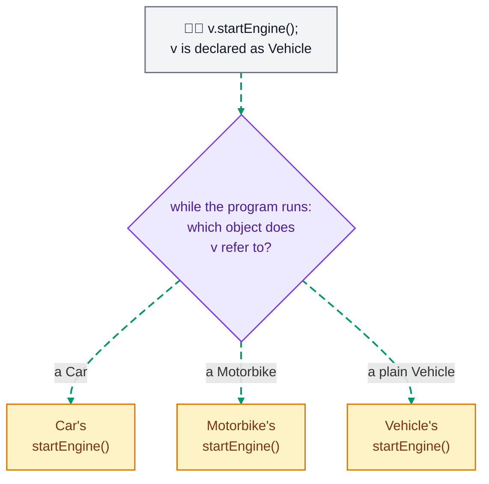
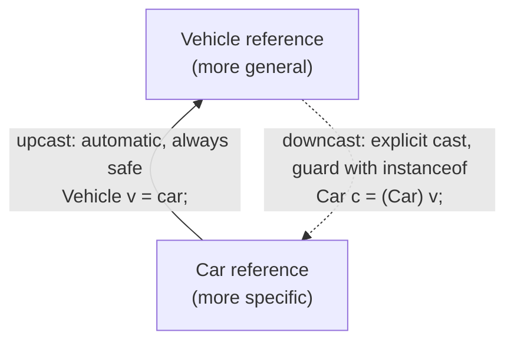

# Java Polymorphism Lab

## What you'll learn

By the end of this lab you will be able to:

- Override a method in subclasses, so that one call through a superclass variable runs a different version for each kind of object (runtime polymorphism)
- Overload a method: one name with several parameter lists, where the compiler picks the version from the arguments (compile-time polymorphism)
- Upcast and downcast references, checking with `instanceof` before every downcast
- Keep different subclasses in one array of their superclass type, process them all in one loop, and add a new subclass without changing that loop
- Override `toString()` and `equals()`, the methods every class inherits from `Object`

## Table of Contents

1. [Runtime Polymorphism: Method Overriding](#1-runtime-polymorphism-method-overriding)
2. [Compile-time Polymorphism (Method Overloading)](#2-compile-time-polymorphism-method-overloading)
3. [Upcasting and Downcasting](#3-upcasting-and-downcasting)
4. [One Array, Many Animals](#4-one-array-many-animals)
5. [Adding a New Subclass](#5-adding-a-new-subclass)
6. [Overriding toString and equals](#6-overriding-tostring-and-equals)

## Getting started

This lab lives in the package `week10.polymorphism_lab` - this folder. A runnable `Main.java` is already here: open this folder in VS Code or your Codespace, click ▶ on `Main.java` to check your setup works. Use this one `Main.java` throughout the lab to create and test your objects; replace its test code as each exercise develops the program. When an exercise asks you to define a class, give that class its own file beside `Main.java`: `Shape.java`, `Square.java` and `Circle.java` for DIY 1, `PriceCalculator.java` for DIY 2, and so on. Section 4 hands you three classes to copy: give each of them its own file too. Every new file starts with the package line you see in `Main.java`. Code shown in this lab without a class around it goes inside `main`.

## 1. Runtime Polymorphism: Method Overriding

A subclass **overrides** a method when it declares a method with the same signature as one it inherits (the same name and the same parameter types) and gives it a new body. Here `Car` and `Motorbike` both override `startEngine()` from `Vehicle`:

```java
public class Vehicle {
    public void startEngine() {
        System.out.println("Starting the engine");
    }
}
```

```java
public class Car extends Vehicle {
    @Override
    public void startEngine() {
        System.out.println("Starting the car with a key fob");
    }

    public void drive() {
        System.out.println("The car is driving");
    }
}
```

```java
public class Motorbike extends Vehicle {
    @Override
    public void startEngine() {
        System.out.println("Starting the motorbike with a kick");
    }
}
```

`drive()` is a method that only `Car` has; section 3 uses it. A variable of type `Vehicle` can refer to a `Car` or a `Motorbike`, because both are vehicles. Calling `startEngine()` through that variable runs the version in the object's own class:

```java
Vehicle v = new Car();
v.startEngine();          // Starting the car with a key fob
v = new Motorbike();
v.startEngine();          // Starting the motorbike with a kick
```

The compiler only checks that `Vehicle`, the type of the variable, has a `startEngine()` method. Which version runs is decided while the program runs, from the object `v` refers to at that moment. That is why overriding is called **runtime polymorphism**:



*How to read this diagram: the grey box is the call in `main`, the purple box is the question Java asks each time the call runs, and the amber boxes are the three versions of the method. The answer decides which one runs.*

Write `@Override` above every overriding method. It is optional, but it asks the compiler to check that the method really overrides one in the superclass, so a misspelt name such as `startEngin()` becomes a compile error instead of a new, unrelated method.

### DIY 1: Basic Shapes

1. Create a `Shape` class with one method, `getPerimeter()`, that returns `0.0`.
2. Create two subclasses of `Shape`: `Square`, with a private `double side` set by its constructor, and `Circle`, with a private `double radius` set by its constructor.
3. In each subclass, override `getPerimeter()`, marked `@Override`: a square's perimeter is `4 * side` and a circle's is `2 * Math.PI * radius`.
4. In `Main.java`'s `main` method, create a `Square` with side `4.0` and a `Circle` with radius `5.0`, store each one in a variable of type `Shape`, and print each perimeter with the labels shown below.

**Expected output**

```text
Square perimeter: 16.0
Circle perimeter: 31.41592653589793
```

<details><summary>Hint</summary>

`Shape square = new Square(4.0);` stores a `Square` in a `Shape` variable. The compiler accepts `square.getPerimeter()` because `Shape` has a `getPerimeter()` method, which is why `Shape` needs one even though it only returns `0.0`; when the program runs, `Square`'s version is the one that runs. `Shape` has no fields, so the subclass constructors do not need to call `super(...)` themselves (Java adds `super();` for you): they only set their own field, as in `this.side = side;`.

</details>

## 2. Compile-time Polymorphism (Method Overloading)

**Method overloading** means that one class has several methods with the same name but different parameter lists. Java tells them apart by their **signature**: the method name plus the number, types and order of its parameters. The return type and the parameter names are not part of the signature, so two methods that differ only in those cannot be in the same class. Overloading needs no keyword.

```java
public class Calculator {
    public int add(int x, int y) {
        return x + y;
    }

    public int add(int x, int y, int z) {
        return x + y + z;
    }

    public double add(double x, double y) {
        return x + y;
    }
}
```

```java
Calculator calc = new Calculator();
System.out.println(calc.add(5, 3));        // add(int, int) runs: 8
System.out.println(calc.add(5, 3, 2));     // add(int, int, int) runs: 10
System.out.println(calc.add(5.5, 3.5));    // add(double, double) runs: 9.0
```

The compiler reads the arguments of each call and picks the method whose parameter list matches them, before the program runs. That is why overloading is called **compile-time polymorphism**. A call that matches no signature, such as `calc.add("Hello", 5)`, does not compile.

### DIY 2: Shop Price Calculator

1. Create a `PriceCalculator` class with three overloaded methods, all called `calculatePrice` and all returning a `double`:
   * `calculatePrice(double basePrice)` returns the price with no discount
   * `calculatePrice(double basePrice, double discountPercent)` returns the price after taking off that percentage
   * `calculatePrice(double basePrice, boolean hasStudentId)` returns the price with $5 off when `hasStudentId` is `true`, and the full price when it is `false`
2. In `Main.java`'s `main` method, create a `PriceCalculator` and print the price of a $50.00 item three times: with no discount, with a 20% discount, and with the student discount. Use the labels shown below.

**Expected output**

```text
Regular price: $50.0
After 20% discount: $40.0
After student discount: $45.0
```

<details><summary>Hint</summary>

The compiler picks the overload from the arguments alone: `calculatePrice(50.00)` has one argument, `calculatePrice(50.00, 20.0)` matches `(double, double)`, and `calculatePrice(50.00, true)` matches `(double, boolean)`. The amount a percentage discount takes off is `basePrice * discountPercent / 100`.

</details>

## 3. Upcasting and Downcasting

A variable of a superclass type can refer to an object of any of its subclasses. Changing the type of the reference, up or down the class hierarchy, is called casting:

- **Upcasting** goes from a subclass to its superclass, such as from `Car` to `Vehicle`. It is automatic and always safe, because every `Car` is a `Vehicle`. The object does not change, but through a `Vehicle` variable you can only call methods that `Vehicle` has.
- **Downcasting** goes back down, from `Vehicle` to `Car`. It needs an explicit cast, `(Car)`, and it only works if the object really is a `Car`. If it is not, the program compiles but throws a `ClassCastException` when the cast runs. So check first with `instanceof`, which is `true` when the object really is of that type.



With the `Vehicle` and `Car` classes from section 1:

```java
Car car = new Car();
Vehicle v = car;              // upcast: automatic
v.startEngine();              // Car's version runs: Starting the car with a key fob
// v.drive();                 // does not compile: Vehicle has no drive() method

if (v instanceof Car) {       // is the object really a Car? Yes
    Car c = (Car) v;          // downcast: an explicit cast
    c.drive();                // The car is driving
}
```

If `v` referred to a plain `new Vehicle()`, the `instanceof` test would be `false` and the cast would be skipped. Without the test, `(Car)` on a plain `Vehicle` compiles, but throws a `ClassCastException` when it runs.

### DIY 3: Shape Type Conversion

Use your `Shape`, `Square` and `Circle` classes from DIY 1.

1. Give `Square` a method that only `Square` has, `getDiagonal()`, which returns `side * Math.sqrt(2)`.
2. In `main`, replace DIY 1's code with an upcast, `Shape s = new Square(2.0);`, and print `"Perimeter: " + s.getPerimeter()`. `Square`'s version runs, because the object is a `Square`.
3. Add the line `s.getDiagonal();` and read the compile error, `cannot find symbol`: the compiler only looks at the type of the variable, `Shape`, and `Shape` has no `getDiagonal()`. Delete the line.
4. Downcast safely: inside `if (s instanceof Square) { ... }`, cast `s` to a `Square` variable and print `"Diagonal: "` followed by its `getDiagonal()`.
5. Create `Shape c = new Circle(1.0);` and give it the same `instanceof` check and cast to `Square`, with an `else` that prints `Not a Square - cast prevented`. Then, just once, add the cast without the check, `Square bad = (Square) c;`, and run: the program stops with a `ClassCastException`. Delete that line again.

**Expected output**

```text
Perimeter: 8.0
Diagonal: 2.8284271247461903
Not a Square - cast prevented
```

<details><summary>Hint</summary>

The check and the cast go together:

<!-- no-compile -->
```java
if (s instanceof Square) {
    Square sq = (Square) s;
    System.out.println("Diagonal: " + sq.getDiagonal());
}
```

The check on `c` has the same shape, plus an `else`. A `Circle` is a `Shape` but not a `Square`, so `c instanceof Square` is `false` and the `else` runs.

</details>

## 4. One Array, Many Animals

Every `Dog` and every `Cat` is an `Animal`, so one array of type `Animal[]` can hold both. Each object is upcast automatically as it goes into the array, and it keeps its real type. A loop over the array can call an `Animal` method on every element, and each object runs its own version. To call a method that only one subclass has, check the element with `instanceof` and downcast it first, as in section 3.

DIY 4, 5 and 6 use these three classes. Copy each one into its own file beside `Main.java`: `Animal.java`, `Dog.java` and `Cat.java`.

```java
public class Animal {
    protected String name;

    public Animal(String name) {
        this.name = name;
    }

    public void makeSound() {
        System.out.println(name + " makes a sound");
    }
}
```

```java
public class Dog extends Animal {
    public Dog(String name) {
        super(name);
    }

    @Override
    public void makeSound() {
        System.out.println(name + " barks: Woof!");
    }

    public void fetch() {
        System.out.println(name + " fetches the ball");
    }
}
```

```java
public class Cat extends Animal {
    public Cat(String name) {
        super(name);
    }

    @Override
    public void makeSound() {
        System.out.println(name + " meows: Meow!");
    }
}
```

`name` is `protected` in `Animal`, so `Dog` and `Cat` can use it directly.

### DIY 4: The Animal Array

1. In `main`, declare one array, `Animal[] animals`, holding three objects: `new Dog("Rex")`, `new Cat("Luna")` and `new Dog("Buddy")`.
2. Write a for-each loop over `animals` that calls `makeSound()` on each element.
3. Inside the loop, after `makeSound()`, check whether the element is a `Dog`. If it is, downcast it to a `Dog` variable and call `fetch()`.

**Expected output**

```text
Rex barks: Woof!
Rex fetches the ball
Luna meows: Meow!
Buddy barks: Woof!
Buddy fetches the ball
```

<details><summary>Hint</summary>

An array initializer can hold objects of different subclasses: `Animal[] animals = { new Dog("Rex"), ... };`. The loop starts `for (Animal a : animals) {`. `makeSound()` needs no cast, because `Animal` has it. `fetch()` does: use the `instanceof` check and the cast from section 3, with `Dog` in place of `Car`.

</details>

## 5. Adding a New Subclass

When your DIY 4 loop calls `makeSound()`, it only knows that each element is an `Animal`; it never names a particular kind of animal. So a new subclass needs no change to the loop: give the new class its own `makeSound()`, put one in the array, and the loop runs it. Code that keeps working when new subclasses are added is called **extensible**, and this is one of the main benefits of polymorphism.

The `instanceof` check is different: it names `Dog`, so it only ever does something for dogs. Every new kind of animal that needs special treatment would need another `instanceof` check in the loop. So when every kind of animal should do something, give `Animal` a method and override it in the subclasses, instead of adding `instanceof` checks.

### DIY 5: Adding a Horse

1. Create a `Horse` class that extends `Animal`. Its constructor passes the name to `super`, and it overrides `makeSound()` to print `<name> neighs: Neigh!`.
2. Add `new Horse("Star")` as the last element of the `animals` array from DIY 4. Change nothing else, and run the program.

**Expected output**

```text
Rex barks: Woof!
Rex fetches the ball
Luna meows: Meow!
Buddy barks: Woof!
Buddy fetches the ball
Star neighs: Neigh!
```

The loop printed Star's sound, and you did not change the loop. Star does not fetch the ball: a `Horse` is not a `Dog`, so the `instanceof Dog` check is `false` for it.

<details><summary>Hint</summary>

`Horse` has the same shape as `Cat` in section 4: a constructor that calls `super(name)`, and one `makeSound()` method marked `@Override`.

</details>

## 6. Overriding toString and equals

Every class extends `Object`, even one with no `extends`, so every object already has a `toString()` method and an `equals()` method. The versions in `Object` are not much use:

```java
public class Coin {
    private int value;

    public Coin(int value) {
        this.value = value;
    }
}
```

```java
Coin a = new Coin(50);
Coin b = new Coin(50);

System.out.println(a);             // week10.polymorphism_lab.Coin@1dbd16a6
System.out.println(a == b);        // false
System.out.println(a.equals(b));   // false
```

`System.out.println(a)` calls `a.toString()` for you, and `Object`'s version returns the class name and a hash code (yours will be a different number). `Object`'s `equals()` returns `true` only for the very same object, just like `==`, so two separate coins worth 50c are not equal. Overriding both methods makes `Coin` print and compare the way you mean:

```java
public class Coin {
    private int value;

    public Coin(int value) {
        this.value = value;
    }

    @Override
    public String toString() {
        return "Coin(" + value + "c)";
    }

    @Override
    public boolean equals(Object other) {
        if (!(other instanceof Coin)) {
            return false;
        }
        Coin c = (Coin) other;
        return value == c.value;
    }
}
```

Now `System.out.println(a)` prints `Coin(50c)` and `a.equals(b)` is `true`, while `a == b` is still `false`: they are still two separate objects.

`equals` takes an `Object`, not a `Coin`, because an overriding method must have the same signature as the method it overrides, and `Object`'s `equals` takes an `Object`. That is why the body starts with an `instanceof` check and a downcast. A class that overrides `equals()` should also override `hashCode()`; this lab does not need it.

### DIY 6: Overriding Object's methods: toString and equals

1. In the `Cat` class from section 4, override `toString()`, marked `@Override`, so that it returns `Cat: <name>`.
2. In `main`, replace DIY 5's code with two separate `Cat` objects that have the same name: `Cat a = new Cat("Luna");` and `Cat b = new Cat("Luna");`. Print `a` with `System.out.println(a);`.
3. Print `a == b`, then print `a.equals(b)`, and run the program. Both print `false`: the `equals()` that `Cat` inherits from `Object` only checks for the same object, like `==`.
4. Override `equals(Object other)` in `Cat`, marked `@Override`. Return `false` unless `other` is a `Cat`; otherwise cast `other` to `Cat` and return whether the two names are equal. Run it again: `a.equals(b)` is now `true`, and `a == b` is still `false`.

**Expected output**

```text
Cat: Luna
false
true
```

*This is the run after step 4. At step 3, before you override `equals()`, the last line prints `false`.*

<details><summary>Hint</summary>

`toString()` returns the `String` and `println` prints it, so its body is a single `return`. Compare the two names with `name.equals(c.name)`, never with `==`. `name` is `protected` in `Animal`, so `Cat` can read it directly, both its own `name` and `c.name`. The whole method has the same shape as `Coin`'s `equals` above:

<!-- no-compile -->
```java
@Override
public boolean equals(Object other) {
    if (!(other instanceof Cat)) {
        return false;
    }
    Cat c = (Cat) other;
    return ...;
}
```

</details>

## Summary

- **Method overriding** is runtime polymorphism: a subclass gives an inherited method a new body with the same signature, and a call through a superclass variable runs the version of the object it refers to.
- **Method overloading** is compile-time polymorphism: one class has methods with the same name but different parameter lists, and the compiler picks one from the arguments.
- **Upcasting** is automatic and always safe. **Downcasting** needs an explicit cast, and an `instanceof` check first prevents a `ClassCastException`.
- One array of a superclass type can hold objects of every subclass, and a loop over it keeps working when a new subclass is added.
- `toString()` and `equals()` come from `Object`, and you override them like any other inherited method.
