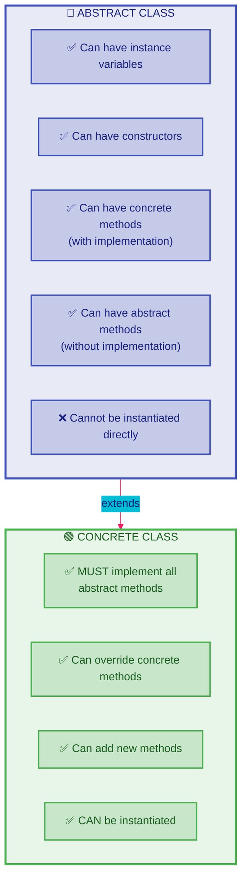
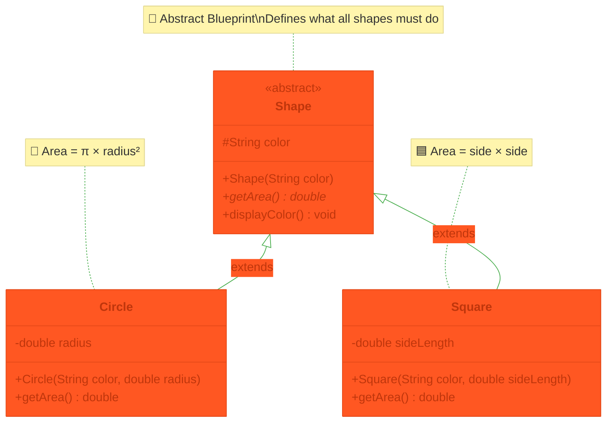
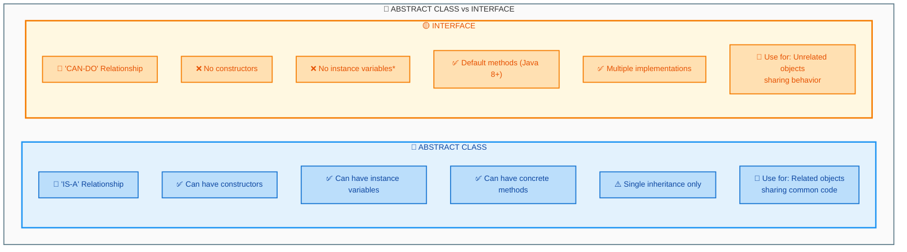
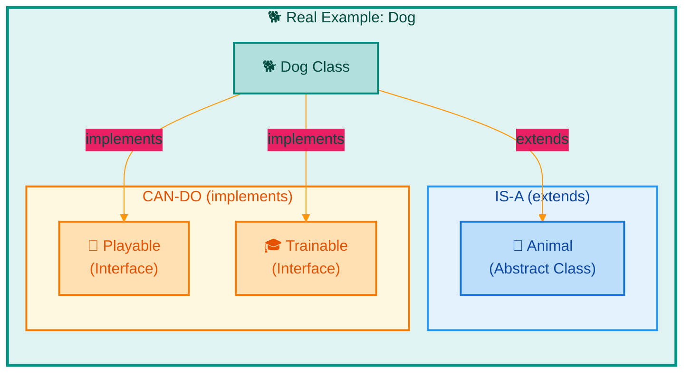
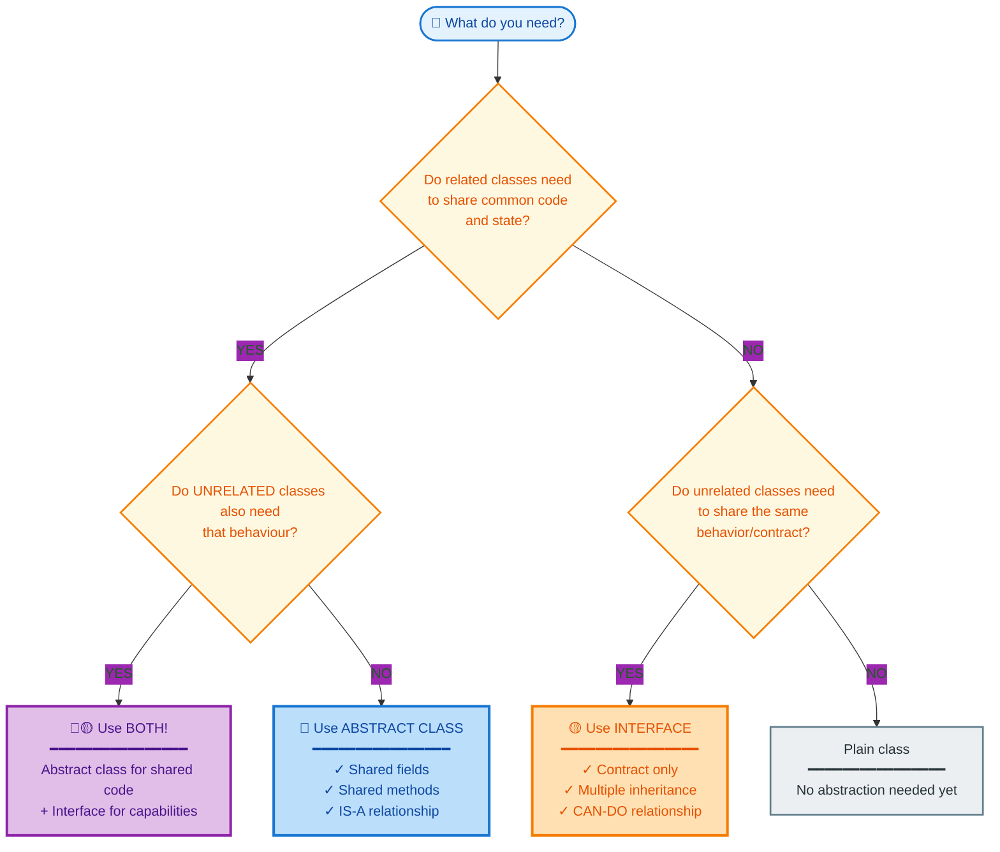

# Java Abstraction Lab

## What you'll learn

**Abstraction** means showing what a method does while hiding how it does it: code that calls a method needs only its signature (its name and parameters), not its body. Java gives you two tools for it, abstract classes and interfaces. By the end of this lab you will be able to:

- Write an abstract class, and extend it with concrete subclasses that each write its abstract methods
- Write an interface, and implement it in your own classes
- Write a class that extends one class and implements one or more interfaces
- Program to an interface: write a method that accepts any class implementing an interface, so that new classes can be added without changing it (the Open/Closed Principle)
- Choose between an abstract class ("is-a") and an interface ("can-do") for a design

## Table of Contents
1. [Abstract Classes](#1-abstract-classes)
2. [Interfaces](#2-interfaces)
3. [Abstract Classes vs. Interfaces](#3-abstract-classes-vs-interfaces)
4. [Programming to an Interface](#4-programming-to-an-interface)
5. [Choosing the Right Tool](#5-choosing-the-right-tool)

## Getting started

This lab lives in the package `week11.abstraction_lab` - this folder. A runnable `Main.java` is already here: open this folder in VS Code or your Codespace, click ▶ on `Main.java` to check your setup works. Use this one `Main.java` throughout the lab to create and test your objects; replace its test code as each exercise develops the program. When an exercise asks you to define a class or an interface, give it its own file beside `Main.java`: `Shape.java`, `Circle.java` and `Square.java` for DIY 1, `GameCharacter.java` and `Hero.java` for DIY 2, and so on. Every new file starts with the package line you see in `Main.java`. The exercises build on each other, so keep every class you write: later exercises use them again.

## 1. Abstract Classes

### What is an Abstract Class?

An **abstract class** is a class declared with the keyword `abstract`. It cannot be instantiated: `new` cannot create an object of it, so it exists only to be extended. Like any class, it can hold instance variables, constructors and complete methods (with a body), which every subclass shares. It can also declare **abstract methods**: a signature ending in a semicolon, with no body. Every concrete (non-abstract) subclass must implement each abstract method it inherits.



### Code Example: Animal Sounds

Every animal makes a sound, but no one sound fits every animal, so `makeSound()` is abstract and each subclass writes its own:

```java
// This is our abstract class - it defines what all animals can do
public abstract class Animal {
    // Properties that all animals have
    protected String name;
    protected int age;
    
    // Constructor to set up basic animal properties
    public Animal(String name, int age) {
        this.name = name;
        this.age = age;
    }
    
    // Abstract method - each animal must implement their own sound
    public abstract void makeSound();
    
    // Regular method all animals can use as-is
    public void introduce() {
        System.out.println("I am " + name + " and I am " + age + " years old");
    }
}

// A specific type of animal
public class Dog extends Animal {
    public Dog(String name, int age) {
        super(name, age);
    }
    
    // Dog's specific implementation of makeSound
    @Override
    public void makeSound() {
        System.out.println("Woof! Woof!");
    }
}

// Another type of animal
public class Cat extends Animal {
    public Cat(String name, int age) {
        super(name, age);
    }
    
    // Cat's specific implementation of makeSound
    @Override
    public void makeSound() {
        System.out.println("Meow!");
    }
}
```

Using these animals:
```java
public class Main {
    public static void main(String[] args) {
        // Create some animals
        Animal spot = new Dog("Spot", 3);
        Animal whiskers = new Cat("Whiskers", 2);
        
        // Make them introduce themselves and make sounds
        spot.introduce();      // Prints: I am Spot and I am 3 years old
        spot.makeSound();      // Prints: Woof! Woof!
        
        whiskers.introduce();  // Prints: I am Whiskers and I am 2 years old
        whiskers.makeSound();  // Prints: Meow!
    }
}
```

### DIY 1: Simple Shape System
Create a basic shape system with three classes, `Shape`, `Circle` and `Square`, and test them from `Main.java`.



1. Copy this abstract class into a new file `Shape.java`. It is the only class in this lab you are given complete: notice where `abstract` goes, on the class and on `getArea()`.
```java
public abstract class Shape {
    protected String color;
    
    public Shape(String color) {
        this.color = color;
    }
    
    // Every shape must implement this
    public abstract double getArea();
    
    // All shapes can use this as-is
    public void displayColor() {
        System.out.println("I am " + color + " in color");
    }
}
```

2. Create a class named `Circle` which extends the `Shape` class:
   - Add a `radius` instance variable (type `double`)
   - Add a constructor that takes `color` and `radius` as parameters
   - Implement the `getArea()` method using the formula: `π × radius²`

3. Create a class named `Square` which extends the `Shape` class:
   - Add a `sideLength` instance variable (type `double`)
   - Add a constructor that takes `color` and `sideLength` as parameters
   - Implement the `getArea()` method using the formula: `sideLength × sideLength`

4. In `Main.java`'s `main`, create a red circle of radius `5.0` and a blue square of side `4.0`, each in a variable of type `Shape`: `Shape circle = new Circle("Red", 5.0);`. For each shape, print its area with the label shown below, then call its `displayColor()`.

5. Check the rule: add `Shape shape = new Shape("Green");` to `main` and run. The compiler stops with `error: Shape is abstract; cannot be instantiated`. Delete that line again.

> **Note:** The variables have type `Shape`, not `Circle` or `Square`. A variable of an abstract class's type can hold an object of any of its concrete subclasses, just like `Animal spot = new Dog("Spot", 3);` above.

**Expected output**

```text
Circle area: 78.53981633974483
I am Red in color
Square area: 16.0
I am Blue in color
```

<details><summary>Hint</summary>

The first line of each constructor passes the color up to `Shape`'s constructor: `super(color);`. Use `Math.PI * radius * radius` for the circle's area. To print an area with a label, use `System.out.println("Circle area: " + circle.getArea());` - and the same idea for the square.

</details>

## 2. Interfaces

### What is an Interface?

An **interface** is like an abstract class in which every method is abstract: it lists method signatures, each ending in a semicolon, with no bodies. You declare it with the keyword `interface` instead of `class`. Its methods are implicitly `public abstract`, so you do not write those words, and any variable in an interface is a constant (implicitly `public static final`). An interface has no constructors and cannot be instantiated. (Since Java 8 an interface may also contain `default` and `static` methods, which do have bodies, but every method in this lab's interfaces is abstract.)

A class **implements** an interface with the keyword `implements`. It must then give every method the interface lists a body, with exactly the same signature, and make each of those methods `public`. An interface works like a contract: a class that implements it promises to provide every one of its methods.

### Code Example: Musical Instruments

```java
// The interface lists the methods every musical instrument must have
public interface MusicalInstrument {
    void play();
    void stop();
}

// A piano that implements the MusicalInstrument interface
public class Piano implements MusicalInstrument {
    @Override
    public void play() {
        System.out.println("Piano playing beautiful music");
    }

    @Override
    public void stop() {
        System.out.println("Piano stopped playing");
    }
}

// A guitar that also implements MusicalInstrument
public class Guitar implements MusicalInstrument {
    @Override
    public void play() {
        System.out.println("Guitar strumming chords");
    }

    @Override
    public void stop() {
        System.out.println("Guitar stopped playing");
    }
}
```

### DIY 2: Simple Game Character
Create an interface for game characters, and one character that implements it:

1. Create an interface named `GameCharacter` with two method signatures, written like `MusicalInstrument` above (no bodies):
   - `void move()` - no parameters, returns nothing
   - `void speak()` - no parameters, returns nothing

2. Create a class named `Hero` that implements `GameCharacter`: its `move()` prints `Hero charges forward!` and its `speak()` prints `For justice!`.

3. In `main`, create a `Hero` in a variable of type `GameCharacter` (`GameCharacter hero = new Hero();`), then call its `move()` and its `speak()`.

4. Check that interface methods must be public: delete the word `public` from `Hero`'s `speak()` and run. The compiler stops with `error: speak() in Hero cannot implement speak() in GameCharacter` and the reason `attempting to assign weaker access privileges; was public`. Put `public` back.

5. Check that every method must be implemented: delete the whole `speak()` method from `Hero` and run. The compiler stops with `error: Hero is not abstract and does not override abstract method speak() in GameCharacter`. Undo the deletion.

**Expected output**

```text
Hero charges forward!
For justice!
```

<details><summary>Hint</summary>

Write `GameCharacter` the same way `MusicalInstrument` is written above: `public interface GameCharacter {`, then one signature per line, each ending in a semicolon. Then follow the `Piano` pattern: `public class Hero implements GameCharacter { ... }`, with an `@Override public void` method for each of `move()` and `speak()` that prints the hero's line.

</details>

## 3. Abstract Classes vs. Interfaces

### Simple Comparison
Think of it this way:
- Abstract Class: "is-a" relationship (a Dog is an Animal)
- Interface: "can-do" relationship (a Bird can Fly)



*\*An interface can still hold constants: variables that are implicitly `public static final`.*

A class can **extend only one** class, but it can **implement as many interfaces as it needs**, and it can do both at once: `extends` comes first, then `implements`, with several interfaces separated by commas, as in `public class Dog extends Animal implements Playable, Trainable`.



### DIY 3: Drawable Circle
`Circle` from DIY 1 already extends `Shape`, and a class can extend only one class. To make circles drawable as well, `Circle` will also implement an interface:

1. Create an interface named `Drawable` with one method signature: `void draw()` - no parameters, returns nothing.

2. Change the first line of `Circle` so that it still extends `Shape` and also implements `Drawable`.

3. Add a `draw()` method to `Circle` that prints the word `Drawing a`, the circle's `color` and the word `circle`, with a space between each, so that a red circle prints `Drawing a Red circle`. `Circle` can use `color` directly because it inherits that `protected` instance variable from `Shape`.

4. In `main`, create a red circle of radius `5.0` in a variable of type `Circle`, call its `draw()`, then print its area labelled as in DIY 1.

**Expected output**

```text
Drawing a Red circle
Circle area: 78.53981633974483
```

<details><summary>Hint</summary>

The first line of `Circle` becomes `public class Circle extends Shape implements Drawable {` - `extends` always comes before `implements`. The rest of `Circle` stays as it was; you only add an `@Override public void draw()` method. A `Circle` is now both a `Shape` and a `Drawable`, so `Shape s = circle;` and `Drawable d = circle;` would both compile.

</details>

## 4. Programming to an Interface

### Why Program to an Interface?
When a method's parameter type is an interface, you can pass it an object of ANY class that implements that interface. This means:
- One method works with every class that implements the interface, including classes written after the method
- You add a new kind of object by writing a new class, without changing code that already works

### The Open/Closed Principle

This follows a well-known software design principle, the **Open/Closed Principle**:

> **"Software entities should be open for extension, but closed for modification."**

What does this mean in practice?

| Concept | Meaning | Example |
|---------|---------|---------|
| **Open for Extension** | You can add new functionality | Add a new `Wizard` class that implements `GameCharacter` |
| **Closed for Modification** | You don't need to change existing code | A method that takes a `GameCharacter` works with the new `Wizard` without ANY changes |

> **Why is this important?** In real-world applications, modifying existing code can introduce bugs. By following the Open/Closed Principle, you can add new features without risking breaking what already works!

### DIY 4: Taking Turns
In a game, every character takes its turn the same way: it moves, then it speaks. Write that once, for any `GameCharacter`:

1. In `Main.java`, beside `main`, write a method `public static void takeTurn(GameCharacter character)` that calls `character.move()` and then `character.speak()`. Its parameter's type is the interface `GameCharacter`, so it accepts a `Hero`, or an object of any other class that implements `GameCharacter`.

2. In `main`, call `takeTurn(new Hero());`.

3. Now add a new kind of character without changing `takeTurn`: create a class `Wizard` that implements **two** interfaces, `GameCharacter` and your `Drawable` from DIY 3. Its `move()` prints `Wizard teleports!`, its `speak()` prints `Abracadabra!` and its `draw()` prints `Drawing a wizard`.

4. In `main`, after the hero's turn, create a `Wizard` in a variable of type `Wizard`, pass it to `takeTurn`, then call its `draw()`.

**Expected output**

```text
Hero charges forward!
For justice!
Wizard teleports!
Abracadabra!
Drawing a wizard
```

<details><summary>Hint</summary>

List both interfaces after `implements`, separated by a comma: `public class Wizard implements GameCharacter, Drawable { ... }`, and give it all three methods. `takeTurn(wizard)` compiles because a `Wizard` is a `GameCharacter`. Keep the wizard in a `Wizard` variable: through a `GameCharacter` variable you could call only `move()` and `speak()`, so `draw()` would not compile. Notice that `takeTurn` did not change when `Wizard` was added: that is the Open/Closed Principle.

</details>

## 5. Choosing the Right Tool

### DIY 5: Choosing the Right Tool

In DIY 1 to DIY 4 the lab told you whether to write an abstract class or an interface. In real design work nobody tells you: you decide, using the comparison in section 3. For each type below, write your decision as a one-line comment directly above its declaration, in the form `// Decision: abstract class - <your one-sentence reason>` or `// Decision: interface - <your one-sentence reason>`.

1. **Look back at `Drawable`** (DIY 3 and DIY 4). Add your decision comment above its declaration: why does it have to be an interface, not an abstract class? Think about what `Circle` already extends, and what a `Wizard` has in common with a shape.

2. **Scenario: payroll.** A company's payroll system will track several kinds of employee, starting with managers. Every employee, of any kind, has a `name` and an `annualSalary` and clocks in exactly the same way, but each kind works out its year-end bonus differently. There is no such thing as a plain employee: every record is a specific kind, such as a `Manager`. Decide what the shared type `Employee` should be, add your decision comment, then build it:
   - `Employee` has a `protected String name` and a `protected double annualSalary`, a constructor that takes both and assigns them, a `clockIn()` method that prints the name followed by ` clocked in`, and a `bonus()` method (returns `double`) with no body of its own - each subclass must supply it
   - `Manager` reuses `Employee`'s fields and constructor; its own `bonus()` returns `annualSalary` multiplied by `0.20`

3. In `main`, create a `Manager` named `Priya` with an annual salary of `60000.0`, in a variable of type `Employee`. Call its `clockIn()`, then print `Bonus: ` followed by its `bonus()`.

**Expected output**

```text
Priya clocked in
Bonus: 12000.0
```

<details><summary>Hint</summary>

For each shared type, ask: does it need to hold state and share a constructor with close relatives (`protected` fields, `super(...)`)? Then it is an abstract class, because an interface can have neither instance variables nor constructors. Does it only need to promise that otherwise unrelated classes can all do the same thing? Then it is an interface, and a class that already extends another class can still implement it. `Manager`'s constructor passes both values up with `super(name, annualSalary);`.

</details>

## Summary
Through these exercises you have:
- Written abstract classes, which cannot be instantiated, share their instance variables, constructors and complete methods with their subclasses, and leave each abstract method for every concrete subclass to write (DIY 1, DIY 5)
- Written an interface, which lists method signatures that any class can promise to implement (DIY 2)
- Combined the two: a class extends at most one class, but can implement many interfaces (DIY 3, DIY 4)
- Programmed to an interface, so that a new class worked with code that never changed (DIY 4)
- Chosen between an abstract class and an interface, and said why (DIY 5)



**Quick Reference Table:**

| Scenario | Use | Example |
|----------|-----|---------|
| Classes share code & state | 🔷 Abstract Class | `Shape` → `Circle`, `Square` |
| Unrelated classes, same behavior | 🟡 Interface | `Drawable` → `Circle`, `Wizard` |
| Both shared code AND shared behavior | 🔷🟡 Both | `Shape` + `Drawable` → `Circle` |
